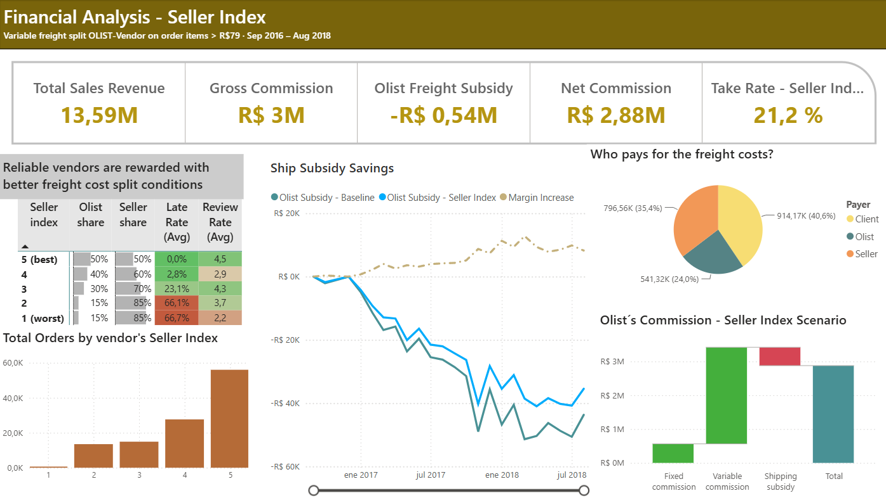
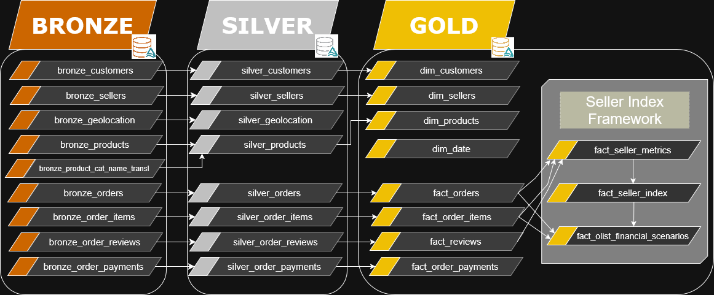
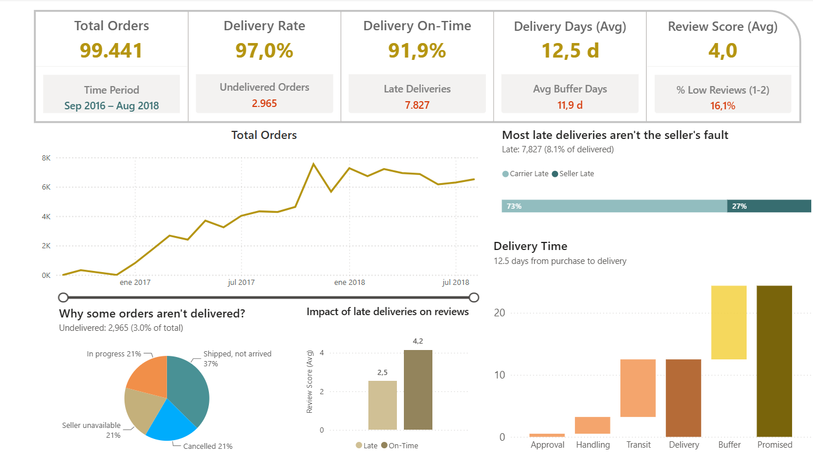
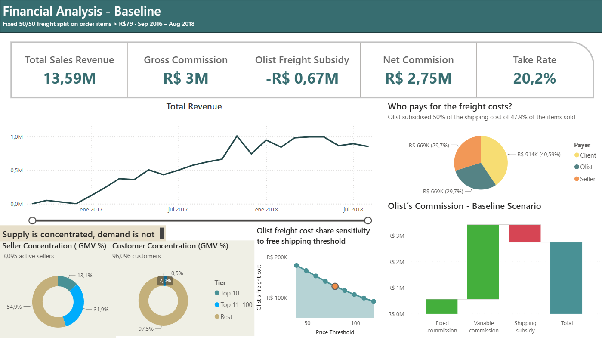

# E-commerce Analytics Platform

**End-to-end analytics project on Databricks: a Medallion data pipeline, a point-in-time Seller Performance Index and a simulation of an incentive-based shipping cost policy for the Olist marketplace (2016–2018).**



## Key results

- **Data pipeline:** Bronze → Silver → Gold pipeline in Databricks (SQL + PySpark, Delta tables). Over ~100k orders, 3,095 sellers and 96k customers.
- **Seller Index:** daily, point-in-time score (1–5) for every active seller, based on late shipments and customer claims, with Bayesian smoothing to avoid penalizing low-volume sellers.
- **The index predicts risk:** sellers with an index of 1–2 are late in **22%** of their shipments over the following 60 days, compared with **5%** for sellers with an index of 5.
- **Business impact:** compared with a flat 50/50 shipping cost split used as baseline, an index-based split reduces OLIST's freight subsidy from **R$669k to R$541k (−19%)** and increases the take rate from **20.2% to 21.2%**, under identical historical demand.

## Business problem

Olist connects small and medium-sized sellers with the main Brazilian marketplaces. It earns a fixed fee per item and a commission on each sale, and part of that revenue is used to cover shipping costs.

Late shipments and customer complaints generate extra logistics costs and damage the customer experience. The goal of the project is to design a **Seller Operational Index** that rewards reliable sellers with a higher shipping subsidy and penalizes unreliable ones, and to measure how different versions of the index would have changed OLIST's costs. The analysis measures the mechanical impact of the policy on historical data; it does not model how sellers would change their behavior in response to it.

## Architecture



| Layer | Content |
|---|---|
| **Bronze** | Raw ingestion of the 9 Kaggle CSV files into Delta tables, with ingestion metadata |
| **Silver** | Cleaning and standardization: trimmed text fields, type casting, standardized zip codes and flags for inconsistent timestamps |
| **Gold** | Star schema (`dim_*`, `fact_*`) plus the Seller Index framework: `fact_seller_metrics` → `fact_seller_index` → `fact_olist_financial_scenarios` |

The Power BI report is built on top of the gold tables.

## Seller Operational Index

For every seller and every day, the index is calculated in five steps:

1. **Point-in-time metrics.** Late-to-carrier rate and claim rate (reviews below 3) over a 60-day window that ends 2 days before the reference date. Reviews are stored as a versioned history, so each date only uses the information available at that moment. Reviews linked to late deliveries caused by the carrier are excluded, since they do not depend on the seller (73% of late deliveries are the carrier's fault).
2. **Bayesian smoothing.** Rates are pulled towards the marketplace average with 8 virtual observations, so a single late order does not ruin the score of a new seller.
3. **Thresholds and caps.** Penalties start above 1% late shipments and 5% claims, and are capped at 20x and 10x the threshold.
4. **Penalty functions.** Three functional forms are compared: linear, quadratic and logistic.
5. **Index and incentive.** Late shipments weigh twice as much as claims. The weighted penalty is mapped to a 1–5 score, which sets OLIST's share of the shipping cost:

| Seller Index | 5 | 4 | 3 | 1–2 | No index (new sellers) |
|---|---|---|---|---|---|
| OLIST share of shipping cost | 50% | 40% | 30% | 15% | 50% (baseline split) |

### Choosing the index version

The three versions are compared with explicit criteria: they must rank sellers by future risk, must not penalize low-volume sellers more than high-volume ones, must be stable over time, and should generate savings without giving the maximum score to almost everyone.

| | Linear | Quadratic | Logistic |
|---|---|---|---|
| Future late rate, index 5 / index 1–2 | 5.1% / 22.2% | 5.6% / 23.7% | 5.1% / 21.4% |
| Low-volume sellers (≤3 orders) with index ≤3 | 15.2% | 15.2% | 29.9% |
| High-volume sellers (≥20 orders) with index ≤3 | 30.4% | 17.5% | 25.2% |
| Index changes per seller and month | 0.52 | 0.41 | 0.87 |
| Seller-days with index 5 | 64.0% | 76.8% | 42.2% |
| Savings vs baseline split | R$128k (19.1%) | R$85k (12.7%) | R$122k (18.3%) |

The **linear index** is selected: the logistic version penalizes low-volume sellers more often, and the quadratic one gives the maximum score to almost four out of five sellers.

The full design, calibration (time window, smoothing, thresholds) and comparison are in [`analysis/seller_index_analysis.ipynb`](analysis/seller_index_analysis.ipynb). The notebook uses the same functions as the production jobs, with its own parameters, so alternative calibrations can be tested without touching the production tables.

## Dashboards

**Logistics**: delivery performance, reasons for undelivered orders and the impact of late deliveries on reviews (2.5 vs 4.2 average score).



**Financial analysis – baseline**: revenue, commissions and who pays the shipping costs under the 50/50 baseline split.



## Data

[Brazilian E-Commerce Public Dataset by Olist](https://www.kaggle.com/datasets/olistbr/brazilian-ecommerce) (Kaggle): ~100k orders placed between 2016 and 2018, with customers, sellers, products, payments, reviews and geolocation.

<details>
<summary>Source data model</summary>


</details>

## Repository structure

```
├── analysis/
│   └── seller_index_analysis.ipynb       Seller Index design, calibration and version selection
├── data_pipeline/
│   ├── 01_bronze/                        Raw ingestion (SQL)
│   ├── 02_silver/                        Cleaning and standardization (SQL)
│   ├── 03_gold/                          Star schema and financial scenarios (SQL)
│   │   └── seller_index/                 Seller Index jobs and shared PySpark functions
│   └── data_pipeline.png
├── data/                                 Source data model (raw data is not versioned)
└── power_bi/screenshots/                 Power BI report pages
```

## How to run it

1. Download the dataset from Kaggle and upload the CSV files to the Databricks volume `/Volumes/marketplace_olist/default/raw_data/`.
2. Run the SQL scripts in `01_bronze`, `02_silver` and `03_gold` (catalog `marketplace_olist`).
3. Run the Seller Index jobs `si1_fact_seller_metrics` and `si2_fact_seller_index`, and then `fact_olist_financial_scenarios.sql`. Production parameters are defined in `seller_index/config_prod.py`.
4. Open `analysis/seller_index_analysis.ipynb` to explore the index with different parameters.

## Tech stack

Databricks · PySpark · Spark SQL · Delta Lake · Python (pandas, matplotlib, seaborn) · Power BI · Git

## Author

**Pablo Martínez Coro** · [LinkedIn](https://www.linkedin.com/in/pablo-martinez-coro)
